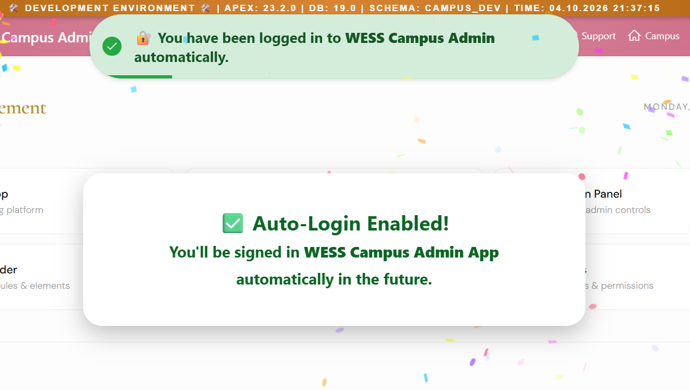
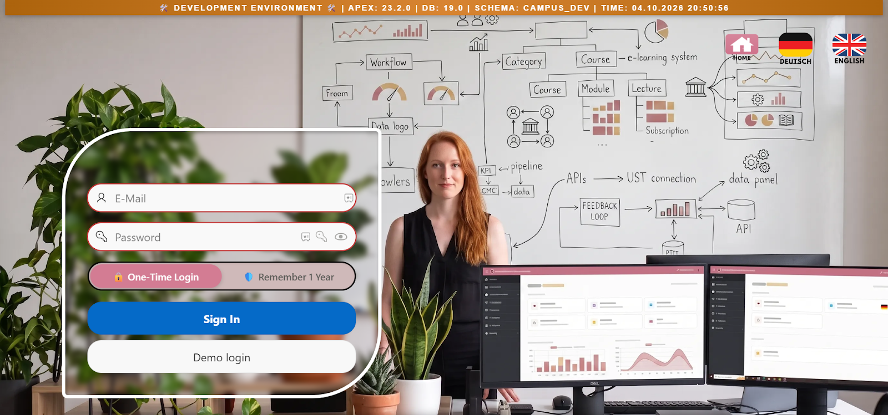
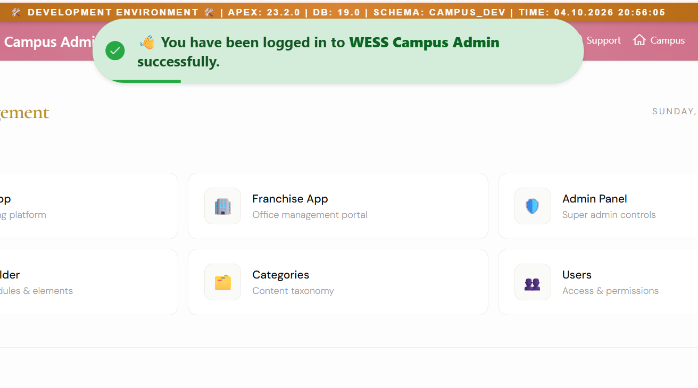
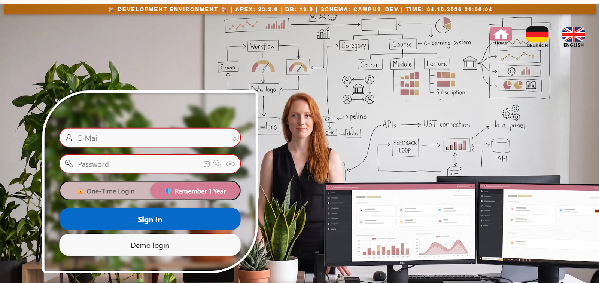

# Auto-Login ("Remember Me" for 1 Year) — Oracle APEX

[](LICENSE)


> A secure, cookie-based **"Remember Me"** for Oracle APEX: sign in once, stay recognized for a year.

<p align="center">
  
</p>

**By Hassaan Ahmed Tahir — Senior Oracle APEX Developer · [Read the full tutorial](https://apexwithhassaan.vercel.app/blog/auto-login-remember-me)**

A proper **"Remember Me"** checkbox for Oracle APEX — once a user signs in with **Auto-Login** ticked, they're recognized automatically for a whole year, even if their APEX session breaks, the tab is closed, or the browser restarts.

It's built entirely with native APEX and PL/SQL: a `Secure; HttpOnly; SameSite=Lax` cookie in the browser, a matching cryptographically random token in the database with a 1-year expiry, three small procedures in the authentication package, and three one-line **Before Header** processes. A manual sign-out clears both the cookie and the database token, so the next visit asks for credentials again.

> ✅ **End result:** Sign in once with "Auto-Login" checked and you're recognized automatically for the next 365 days — with a language-aware welcome message and a little confetti celebration each time auto-login signs you in.

---

## ✨ Features

- **1-year "Remember Me"** — users stay recognized even after the session breaks, the tab closes or the browser restarts
- **Secure cookie** — `Secure; HttpOnly; SameSite=Lax`, holding a 256-bit cryptographically random token
- **Clean sign-out** — logout clears both the browser cookie and the database token, even after the session has ended
- **Self-healing** — expired, unknown or revoked cookies are removed automatically
- **Language-aware** — English / German messages, overlay and cookie expiry
- **Delightful UX** — a welcome message and confetti once per login
- **Fully native** — `OWA_COOKIE`, `htp.p` and Before Header processes; no external auth libraries

---

## 📁 Repository structure

```
apex-auto-login-remember-me/
├── src/
│   ├── prerequisites.sql         # columns, token index, DBMS_CRYPTO grant
│   ├── pr_autologin.sql          # login page: auto sign-in from the cookie
│   ├── pr_logout.sql             # login page: clears the token on sign-out
│   ├── pr_set_cookie.sql         # home page: writes the 1-year cookie
│   └── pr_login_user.sql         # login procedure with pi_auto_login
├── docs/images/                  # screenshots used in this README
├── CHANGELOG.md
├── LICENSE                       # MIT
└── README.md
```

> ⚠️ **Note:** All four procedures live inside the `ADMI_AUTHENTICATION` package. The files contain the procedure bodies — add each one to your package body (and declare them in the package spec), adjusting table and column names to your own schema.

---

## 🚀 Quick install

1. Run [`prerequisites.sql`](./src/prerequisites.sql) (columns, index, `DBMS_CRYPTO` grant)
2. Add `pr_autologin`, `pr_logout` and `pr_set_cookie` to your authentication package, and replace your login procedure with `pr_login_user.sql`
3. Create the application item `AI_WELCOME_SHOWN`, the login-page items, and set the Post-Logout URL (see [Before You Start](#1-before-you-start))
4. Create the two Before Header processes on page 9999 and the one on page 1
5. Run the app over **HTTPS** and sign in with Auto-Login ticked

---

## 📑 Table of Contents

1. [Before You Start](#1-before-you-start)
2. [Create Three Procedures in the Authentication Package](#2-create-three-procedures-in-the-authentication-package)
3. [Wire the Procedures Up as Before Header Processes](#3-wire-the-procedures-up-as-before-header-processes)
4. [Update the Login Procedure to Set the Cookie & Expiry](#4-update-the-login-procedure-to-set-the-cookie--expiry)
5. [How It All Comes Together](#5-how-it-all-comes-together)
6. [Why This Approach Works So Well](#why-this-approach-works-so-well)

---

## 1. Before You Start

### Database

The code uses a `SUPER_ADMIN` table with these auto-login columns alongside the usual user columns (`SUAD_ID`, `SUAD_EMAIL`, `SUAD_ACTIVE_YN`, `SUAD_DELETED_YN`, `SUAD_LAST_LOGIN`, `SUAD_UPDATED`, `SUAD_UPDATED_BY`):

| Column | Purpose |
|---|---|
| `SUAD_AUTO_LOGIN_YN` | Auto-login state: `YES` (just enabled), `REMEMBER` (active, cookie written), `NO` / `NULL` (off) |
| `SUAD_COOKIE` | The 64-character random token stored in the browser cookie |
| `SUAD_COOKIE_EXPIRE_DATE` | When the token stops being accepted (login date + 365) |

[`prerequisites.sql`](./src/prerequisites.sql) adds them, plus an index on `SUAD_COOKIE` for a fast lookup. Your parsing schema also needs a **direct** grant on `DBMS_CRYPTO` (run as SYS / ADMIN):

```sql
GRANT EXECUTE ON SYS.DBMS_CRYPTO TO your_schema;
```

### APEX application

| What | Where | Setting |
|---|---|---|
| Auto-Login checkbox (e.g. `P9999_AUTO_LOGIN`) | Login page 9999 | Checked value `YES` (or `Y`) |
| Hidden item `P9999_LOGOUT_YN` | Login page 9999 | Session State Protection: **Unrestricted** (it's set from the logout URL) |
| Application item `AI_WELCOME_SHOWN` | Shared Components → Application Items | Session State Protection: **Restricted – May not be set from browser** |
| Post-Logout URL | Your authentication scheme | `f?p=&APP_ID.:9999:0::::P9999_LOGOUT_YN:YES` |

> ⚠️ **HTTPS required:** the cookie is marked `Secure`, so browsers only store and send it over HTTPS.

---

## 2. Create Three Procedures in the Authentication Package

Three procedures go inside `ADMI_AUTHENTICATION` — two run on the login page (9999), one on the home page (1).

### 1️⃣ `pr_autologin` — checks for a valid cookie on the login page

[`pr_autologin.sql`](./src/pr_autologin.sql) runs every time the login page loads. It reads the `WESS_CAMPUS` cookie with `OWA_COOKIE.get` and looks up a matching token in `SUPER_ADMIN` with `SUAD_AUTO_LOGIN_YN = 'REMEMBER'` and an expiry date still in the future. If the account is active and not deleted, it logs the user in with `post_login` and sends them to the home page.

If the token is unknown or expired, the stale cookie is removed from the browser. If the account has been deactivated or deleted, the token is revoked in the database too — so the normal login page renders either way.

> 💡 **Tip:** Any other error is swallowed so a broken cookie never breaks the login page — except APEX's own `e_stop_apex_engine` signal, which is re-raised so the redirect from `post_login` always completes cleanly.

### 2️⃣ `pr_logout` — clears the auto-login cookie on manual sign-out

[`pr_logout.sql`](./src/pr_logout.sql) fires when the user lands on the login page after signing out (`P9999_LOGOUT_YN = YES`). It finds the token **by the browser cookie itself** — so it's cleared even though the APEX session has already ended and `APP_USER` is `nobody` — resets the three auto-login columns, expires the cookie in the browser, resets `P9999_LOGOUT_YN`, prints a language-aware (English / German) "logged out" message, and uses `history.replaceState` to clean the address bar so a refresh can't re-trigger the logout.

### 3️⃣ `pr_set_cookie` — fires on the home page after login

[`pr_set_cookie.sql`](./src/pr_set_cookie.sql) runs on the **first** home page load of each login (tracked by `AI_WELCOME_SHOWN`, so clicking *Home* again doesn't repeat it) and reacts to the current `SUAD_AUTO_LOGIN_YN` state:

| State | What happens | Overlay |
|---|---|---|
| `YES` | Auto-login was just switched on — writes the 1-year cookie and flips the flag to `REMEMBER` | ✅ Auto-Login Enabled! |
| `REMEMBER` | The user was logged in automatically via the cookie | 🔐 Welcome back! |
| anything else | A normal, one-time login | — (message only) |

The cookie is written with `Max-Age=31536000` plus an `Expires` date that's always formatted in English and GMT — so German sessions get a valid 1-year cookie too. When auto-login is active, a language-aware overlay fades in and [canvas-confetti](https://github.com/catdad/canvas-confetti) is loaded from jsDelivr for a 7-second burst. The overlay still shows if the CDN is blocked.

---

## 3. Wire the Procedures Up as Before Header Processes

Three lightweight **Before Header** processes call the procedures:

### On Login Page (9999)

| Seq | Process Name | PL/SQL Code | Server-Side Condition |
|---|---|---|---|
| 10 | Clear autologin cookie on manual logout | `ADMI_AUTHENTICATION.pr_logout;` | Item = Value → `P9999_LOGOUT_YN` = `YES` |
| 20 | Check, if cookie exists, then go to auto login page | `ADMI_AUTHENTICATION.pr_autologin;` | — (none) |

> ⚠️ **Order matters:** the logout process must run **before** the auto-login check, so a user who just signed out isn't logged straight back in.

### On Home Page (1)

| Process Name | PL/SQL Code | Server-Side Condition |
|---|---|---|
| Set autologin & cookie | `ADMI_AUTHENTICATION.pr_set_cookie;` | — (none) |

That's the entire wiring — three processes, three one-line calls. All the logic lives inside the package.

---

## 4. Update the Login Procedure to Set the Cookie & Expiry

[`pr_login_user.sql`](./src/pr_login_user.sql) is the updated `Pr_Login_User` with a new parameter:

```sql
pi_auto_login IN VARCHAR2 DEFAULT NULL
```

After a successful authentication:

- **`pi_auto_login` = `YES` / `Y`** → generates a 64-character, cryptographically secure token with `RAWTOHEX(DBMS_CRYPTO.RANDOMBYTES(32))`, stores it in `SUAD_COOKIE`, sets `SUAD_COOKIE_EXPIRE_DATE = SYSDATE + 365` and `SUAD_AUTO_LOGIN_YN = 'YES'`
- **otherwise** → clears all three auto-login fields

It then updates `SUAD_LAST_LOGIN` and calls `post_login` to redirect to the home page, where `pr_set_cookie` writes the cookie. A failed login redirects back to page 9999 with `APEX_UTIL.REDIRECT_URL`.

On the login page, pass your checkbox item into the call, for example:

```sql
ADMI_AUTHENTICATION.Pr_Login_User(
      pi_user_name  => :P9999_USERNAME
    , pi_password   => :P9999_PASSWORD
    , pi_app_id     => :APP_ID
    , pi_auto_login => :P9999_AUTO_LOGIN
);
```

---

## 5. How It All Comes Together

```
Login with Auto-Login ticked
   └─ Pr_Login_User   → random token + 1-year expiry saved, flag = YES
       └─ Home page   → pr_set_cookie writes WESS_CAMPUS cookie, flag = REMEMBER 🎉

Session breaks / browser restarted
   └─ Login page      → pr_autologin finds valid cookie → straight to Home 🔐

Manual sign-out
   └─ Login page      → pr_logout clears DB token (by cookie) + expires cookie 👋
```

- **Simple one-time login** — the checkbox stays unticked, no cookie is written, and signing out (or closing the browser) ends the session normally.
- **Auto-Login enabled** — a secure cookie in the browser and a matching token in the database, both valid for 1 year. If the APEX session breaks, the user lands straight back on the home page, fully recognized.

> ℹ️ **One remembered device per user:** each user has a single token. Enabling Auto-Login on a second device — or signing in there without it — replaces the token, so the first device will ask for credentials again.

---

## Why This Approach Works So Well

- **Secure by design** — the cookie is `Secure; HttpOnly; SameSite=Lax` (never readable by JavaScript, HTTPS only, not sent on cross-site requests), and the token is a 256-bit cryptographically random value
- **Self-cleaning** — manual logout clears both the DB token and the browser cookie, even after the session has ended; expired, unknown or revoked cookies are removed automatically
- **Language-safe** — messages, overlay and cookie expiry all work the same in English and German sessions
- **Graceful fallback** — a broken or missing cookie never breaks the login page, and the overlay still appears if the confetti CDN is blocked
- **Fully native** — built on `OWA_COOKIE`, `htp.p` and standard Before Header processes; no external auth libraries
- **Delightful UX** — a welcome message and confetti once per login, not on every click of *Home*

---

## 📸 Screenshots

<p align="center">
  <br>
  <em>Signing in with Auto-Login left unticked — a plain one-time login</em>
</p>

<p align="center">
  <br>
  <em>The plain "logged in successfully" message — no cookie, no confetti</em>
</p>

<p align="center">
  <br>
  <em>Ticking "Auto-Login" — remembered for a full year on this device</em>
</p>

<p align="center">
  <br>
  <em>"Auto-Login Enabled!" — confetti confirming the 1-year cookie is set</em>
</p>

---

That's the full Auto-Login system — from cookie creation to automatic recognition to clean sign-out — built entirely with native Oracle APEX and PL/SQL. If you add it to your own app, feel free to open an issue and share how it works out!

---

## 📝 Changelog

See [CHANGELOG.md](CHANGELOG.md) for the full version history.

---

## 📄 License

Released under the [MIT License](LICENSE) — free to use, modify and redistribute in personal and commercial projects.

---

## 🙏 Credits

Built by **Hassaan Ahmed Tahir** — Senior Oracle APEX Developer.
Special thanks to **Sajjad Hanifa** for his continued guidance and support in shaping these features and building them right.

📌 Read the full step-by-step write-up on **[APEX with Hassaan](https://apexwithhassaan.vercel.app/blog/auto-login-remember-me)**, and keep an eye on the blog for more Oracle APEX plugins and tutorials.
